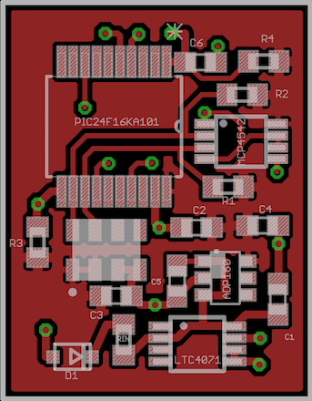
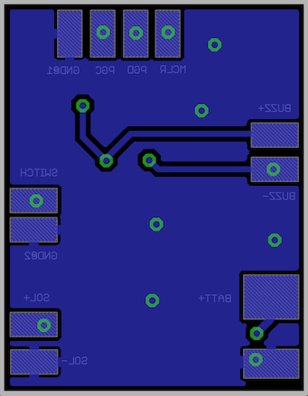
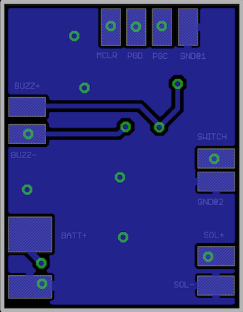
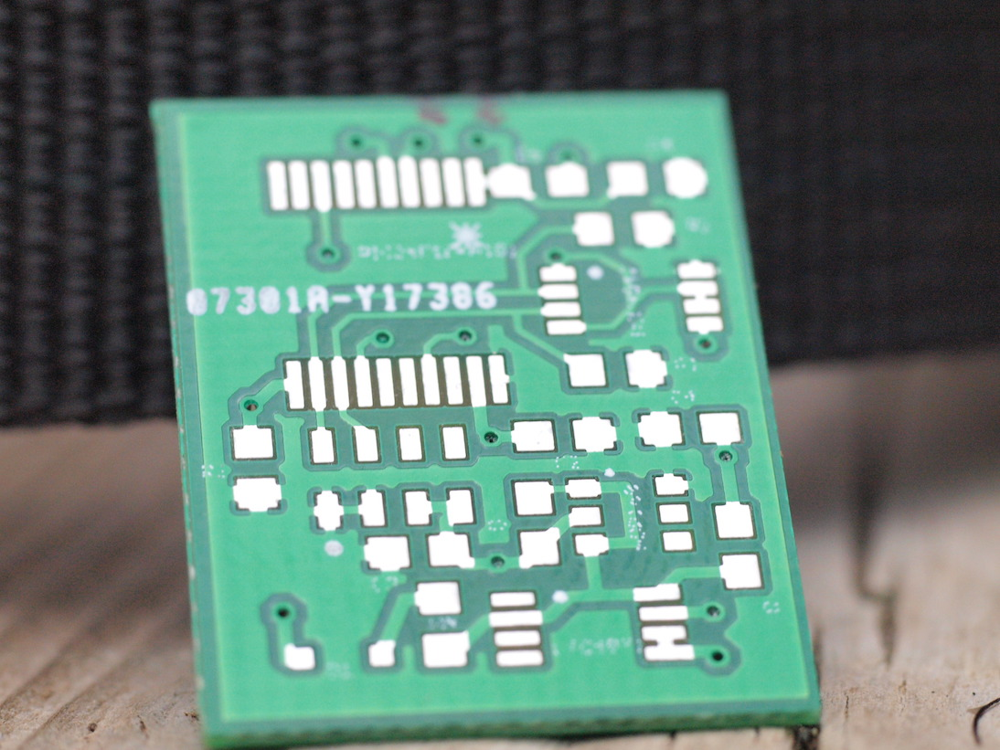
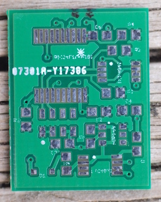
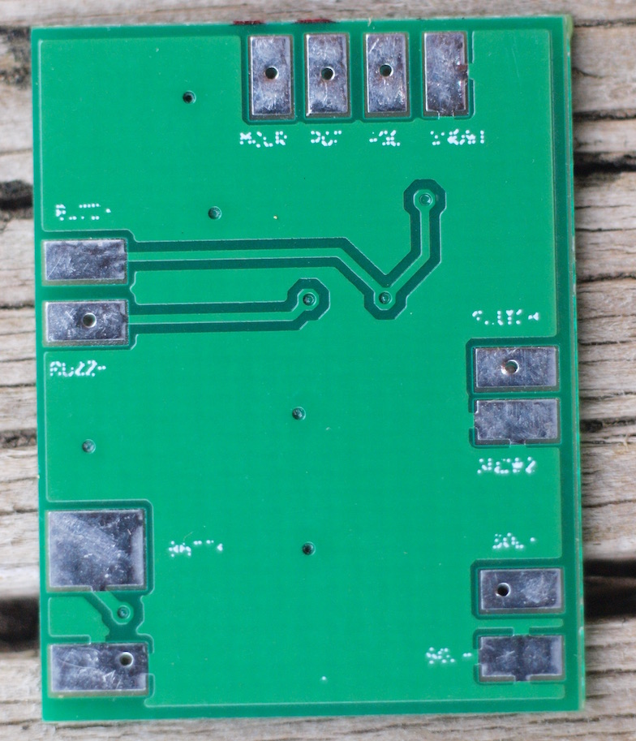
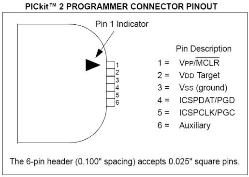

# Lightweight solar variometer for free flight

## Purpose
This project is about buiding a simple, lightweight, energey self-sufficient and helmet embbeded variometer. It is small enough to remain in the helmet's inner coat and draws its energy from the sun. A small battery can provide power during shaded times up to 10 hours.

This repo containsthe sources, pcb design files (eagle format), gerber files and a few instructions to build it, including pictures and bill of materials. The firmware must be loaded into the pic, so you will need a programmer such as a PICKIT or some arduino DIY one.

Key features :
- 1mA@3V power consumption
- 0.1 m/s detection threshold
- no need to recharge or change battery
- embedded in helmet
- 22mm x 17mm pcb size

## Electronic parts needed
The variometer transcribes vertical speed to audio signal and must contain a power manager with a solar panel and a backup battery. Here are the comonent nedded :

* **[MS5611](http://www.te.com/usa-en/product-CAT-BLPS0036.html)** : absolute pressure sensor.

* **[PIC24F16KA101](https://www.microchip.com/wwwproducts/en/PIC24F16KA101)** : this microcontroller is the brain of the vario. It communicates with the pressure sensor, does all the calculations and generates the audio signal. You mest get the 20 leads SSOP package.

* **[MCP4542](https://www.microchip.com/wwwproducts/en/MCP4542)** : Microchip digital I2C potentiometer used to adjust audio volume.

* **[ADP160](http://www.analog.com/en/products/power-management/ldo-linear-regulators/positive-linear-regulators/adp160.html)** : Analog Device ultra low quiescent current ldo regulator. It supplies stabilized power to electronics. Get the 2.8 or 3V version.

* **[LTC4071](http://www.analog.com/media/en/technical-documentation/data-sheets/4071fc.pdf)** : power manager. It havests solar energey and manages system load supplying/battery charging/power path handling. The current shunt limit is 50mA, so make sure your solar panel maximum current is under this value.

* **solar cell** : power supply. The system is designed for 6V/50mA max solar panel. I use two flexible 3V/12mA solar cells (ref [sp3-12](http://www.flexsolarcells.com/index_files/OEM_Components/Flex_Cells/pages/PowerFilm-Solar-OEM-00-Solar-Cell-Module-SP3-12.php)).

* **buzzer** : i like the kingstate's [KPEG006](http://uk.farnell.com/kingstate/kpeg006/receiver-piezo-leads/dp/1299873). It is flat and easy to fit under inner coat.

* **schottky diode** : used to protect solar panel. I use a [Nexperia 1PS76SB10](http://fr.farnell.com/nexperia/1ps76sb10/diode-schottky/dp/1081179?ost=1081179&scope=partnumberlookahead&exaMfpn=true&searchref=searchlookahead&ddkey=http%3Afr-FR%2FElement14_France%2Fw%2Fsearch).

* **3.6 lithium ion battery**. I use a [LIR2016](http://www.eemb.com/public/image/download/LIR2016.pdf).

* some capacitors and resistors (0603 package)

For detailed list of components, including packages and values, see the [part list](https://github.com/samp38/varioSmooth/blob/master/doc/partList.txt).

## PCB

The schematics and GERBER files are in the [pcb folder](pcb).  [iTead pcb protoyping service](https://www.itead.cc/open-pcb/pcb-prototyping/2layer-green-pcb-5cm-x-5cm-max.html) is a good deal to get your boards (10$ for 10 pieces).

## Programming the board
### Binary  file
The code can be found in the [MPLABX project folder](VarioSMooth.X). Microchip's MPLABX IDE is free, as is the XC16 compiler. If you don't feel like building it, just download the [binary file](https://github.com/samp38/varioSmooth/releases/download/v/VarioSMooth.hex) in the [releases page](https://github.com/samp38/varioSmooth/releases).

### Upload to the board
The PIC can be programmed via the MCLR, PGC and PGD pads on the bottom of the board. Ground and a Power must also be ok (VCC from programmer or the solar panel/battery). I used a PICKT 2, very cheap programmer for PICs.

## Wiring & Using
The following elements are to be connected to the board (bottom pads) :
* Switch ('momentary on', i use a key switch like [this one](https://goo.gl/images/q1apYJ)). Pads **SWITCH** and **GND**.
* Solar panel. Pads **SOL+** and **SOL-**.
* Buzzer. Pads **BUZZ+** and **BUZZ-**.
* Battery. Pads **BATT+** and **GND**.

Once everything is set up, just get your solar panel under the sun and it should start up. Short press on button allows to start up or adjust volume, long press to shut down. A 2 minutes time out is set up in order to shut down the system if there is no move detected.

## Open issues

### Firmware
- [x] **False speed spike around 983 mbar (~250 m altitude)**: `vario.c` called `filterPressure()` and `speedIIRFilter()` without including `filters.h`. The implicit declaration returns a 16-bit `int` on XC16, so the filtered pressure (s32, in 0.01 mbar) was truncated to its low 16 bits and sign-extended. When the pressure crossed 983.04 mbar (0x18000) the stored value jumped by 65536, which the vario read as a huge vertical speed for a moment: the vario went crazy briefly when landing in the plains. Fixed by adding the missing includes (`filters.h` in `vario.c`, `timers.h` in `audio.c`) and correcting the prototypes in `timers.h` and `sensor.h`; the firmware now builds with `-Werror=implicit-function-declaration`.
- [ ] **MS5611 vs MS5607 mismatch**: README says MS5611, part list / schematic say MS5607. `sensor.c` uses the MS5611 compensation formulas (`C1<<15`, `C2<<16`, `>>8`, `>>7`). If a MS5607 is fitted, compensated pressure is wrong and the speed scale is off by ~x2. Check which part is actually soldered.
- [ ] **Overflow in `wait(2000)`** (`main.c`): `tmr1_Start(20000)` computes `20000 * FCY` = 5e9, which overflows u32 → actual wait ≈ 280 ms instead of 2 s. Harmless here (sensor needs ~3 ms after reset) but latent bug.
- [ ] **No I2C timeout / ACK check**, and the watchdog is disabled (`ClrWdt()` calls are useless). If a device does not answer, the MCU hangs forever and drains the battery.
- [ ] **`I2C1BRG = 0`** is out of spec (values 0 and 1 are forbidden on PIC24). Works in practice.
- [ ] **`Idle()` is called from inside the Timer1 ISR** while `main()` spins on `Nop()`. Works thanks to wake-without-vectoring, but fragile; `Idle()` should be in the main loop.
- [ ] **`shutdown()` is called from ISRs** (T1 timeout, CN long press). The CN ISR also busy-waits up to ~600 ms, blocking sampling.
- [x] Prototype mismatch: `sns_ReadAdc(s32*)` in `sensor.h` vs `sns_ReadADC(u32*)` in `sensor.c` (implicit declaration).
- [ ] Wrong comment on `_INT0EP` (it is the edge polarity, not the priority).
- [ ] `SPEED_INDEX_MAX 100-1` macro without parentheses.
- [ ] Integer truncation in speed coefficient: `400/30` → 13 (2.5 % bias).
- [ ] Shutdown timeout is 180 s in code (≈200 s effective, since speed is updated every 9 samples, not 8) vs "2 minutes" in this README.
- [ ] No 2nd order temperature compensation, no PROM CRC check on the sensor coefficients.
- [ ] Dead code: `DEE Emulation 16-bit.*`, `Flash Operations.s`, `utils.c`, `tmr3_callback` (T3 interrupt never enabled), commented-out linear regression, `VOL_LOW`.
- [ ] 250 kHz clock limits: audio frequency is heavily quantized at high pitch (14 timer ticks at 2200 Hz → ~7 % steps); s64 math on a 16-bit MCU at this speed leaves little margin.

### Hardware
- [x] **LTC4071 configuration** checked against the datasheet: NTC tied to VCC disables the thermal float derating, NTCBIAS floating is the "not used" setting, ADJ floating selects a 4.1 V float voltage, LBSEL to GND selects a 3.2 V low-battery disconnect. All as intended.
- [ ] **LTC4071 battery reconnection may be marginal**: after a low-battery disconnect, the battery reconnects when VCC reaches VLBC_VCC = 4.19 V typ. (LBSEL = GND, at 1 mA). That is above the 4.1 V float voltage at which the shunt clamps VCC. It only works at low charge current, where the threshold drops. LBSEL to VCC (2.7 V disconnect, 3.6 V reconnect) or ADJ to VCC (4.2 V float) would remove the ambiguity. To be checked on the bench: does a fully discharged vario always come back in the sun?
- [ ] **RIN**: the schematic says 440 Ω, the board has **220 Ω**. Neither is needed: the SP3-12 string is current limited (Isc ≈ 10.7 mA, far below the 50 mA shunt limit), and the datasheet's PV example uses no RIN. With 220 Ω, about 15 % of the harvested power is lost in full sun (estimated).
- [ ] Programming pads are on PGC1/PGD1 but config bits say `ICS_PGx3`: programming works, in-circuit debugging does not.
- [ ] No dedicated VDD pad for the programmer (must go through BATT+ and the LTC4071).
- [ ] PCB link to iTead is outdated (JLCPCB / PCBWay handle the 6/6 mil, 0.3 mm drill rules fine).

### Repo & documentation
- [ ] A Mercurial `.hg/` directory is committed inside the git repo.
- [ ] Generated files are versioned despite `.gitignore`: `build/`, `dist/` (.elf/.hex), `nbproject/private`, `disassembly/`.
- [ ] PCB is in Eagle 7.3 format; Eagle is discontinued by Autodesk → migrate to KiCad.
- [ ] Toolchain is aging: MPLAB X, XC16 1.26, PICkit 2.
- [ ] Part list has encoding issues (`1µ` garbled) and the README has many typos.
- [ ] Part sourcing: LTC4071 is expensive, MCP4542 rather specific.
